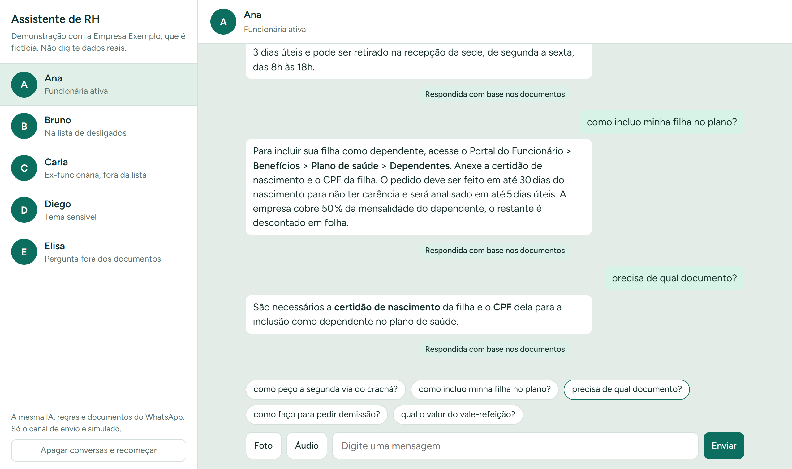

# Agente de RH para WhatsApp

Agente de IA que responde dúvidas comuns de RH (benefícios, crachá, recrutamento, férias) e passa para uma pessoa tudo o que não deve ser automatizado. Projeto de estudo, feito para rodar em planos gratuitos.

> **Tudo aqui é fictício.** A Empresa Exemplo não existe, e as políticas em `knowledge/` foram inventadas para o teste.



## Como funciona

```
Mensagem -> webhook (Supabase Edge Function)
   1. Salva e espera 8 s para juntar mensagens seguidas
   2. Equipe já assumiu a conversa?     -> IA fica em silêncio
   3. Telefone na lista de desligados?  -> resposta pronta, sem IA
   4. Cota do dia acabou?               -> sem resposta, vai para a fila
   5. Anexo ou tema sensível?           -> passa para a equipe, sem IA
   6. Roteador (LLM): intenção + pergunta reescrita com o histórico
        dúvida de RH -> busca nos documentos -> LLM responde com fontes
        sem resposta nos documentos         -> passa para a equipe
```

## Decisões do projeto

- **A IA só responde com base nos documentos.** Uma resposta sem fonte válida não é enviada e vai para a equipe.
- **Regras fixas antes do modelo.** Assédio, saúde, questões jurídicas e anexos não passam pelo modelo para gerar resposta. Pessoas desligadas recebem sempre a mesma mensagem com o e-mail de contato.
- **RAG leve no Postgres.** Busca em português combinada com tolerância a erros de digitação, sem banco vetorial separado.
- **Melhora com aprovação humana.** O sistema redige sugestões a partir das respostas da equipe, e nada entra na base sem revisão.
- **Cota como parte do desenho.** O WhatsApp libera 1.000 mensagens de atendimento grátis por mês. O sistema para em 950 e distribui o saldo pelos dias úteis.
- **Privacidade.** CPF, e-mail e números longos são mascarados antes de serem guardados ou enviados ao modelo, e as conversas são apagadas após 90 dias.

## Resultados e limites

- 31 de 31 perguntas certas na avaliação com o modelo real, sem nenhuma regra inventada ([evals/questions.json](evals/questions.json)).
- 61 testes automatizados, incluindo o SQL em um Postgres local.
- Os números acima usam só dados fictícios. **O projeto não foi testado em produção.**
- A integração com o WhatsApp recebeu mensagens e gerou respostas, mas a Meta bloqueou a entrega na conta pessoal, apontando falta de meio de pagamento e de verificação da empresa. Por isso a demonstração simula apenas o canal de envio.

Tecnologias: TypeScript, Supabase (Edge Functions e Postgres), Groq (LLM e Whisper), WhatsApp Cloud API e Google Apps Script.

## Demonstração sem depender da Meta

A conta de teste da Meta exigiu meio de pagamento e empresa verificada para entregar mensagens. Por isso, a apresentação usa uma tela local que imita a conversa do WhatsApp, com a mesma IA, regras, documentos e banco.

```
npm run demo
```

Abra `http://localhost:3000` no navegador. À esquerda ficam cinco pessoas fictícias, e cada uma tem sugestões de perguntas para o roteiro. Bruno já está na lista de desligados. O botão **Apagar conversas e recomeçar** prepara um novo ensaio.

Para os passos 9 e 10 do roteiro (aprendizado e cota), configure a planilha descrita em "5. Planilha".

## Como colocar no ar

Você precisa de Node 24 e de contas gratuitas na Meta for Developers, no Supabase, no Groq e no Google.

### 1. Supabase

1. Crie um projeto na região São Paulo.
2. Faça login e vincule o projeto:
   ```
   npx supabase login
   npx supabase link --project-ref SEU_REF
   npx supabase db push --remote
   ```
   O `--remote` é obrigatório: sem ele, a CLI 3 tenta o banco local e falha com `ECONNREFUSED 127.0.0.1:54322`. A senha pedida é a do banco de dados, definida ao criar o projeto.

### 2. Groq

1. Crie uma chave em console.groq.com.
2. Em Settings > Data Controls, ative o Zero Data Retention.
3. Em Settings > Limits, confira se os modelos do `.env.example` existem no seu plano e quais são os limites diários.

### 3. WhatsApp

1. Em developers.facebook.com, crie um app do tipo Business e adicione o produto WhatsApp.
2. Em Configuração da API, anote o Phone Number ID e cadastre os celulares de teste. Cada um confirma por código.
3. Crie um token permanente: Configurações do negócio > Usuários do sistema, com as permissões `whatsapp_business_messaging` e `whatsapp_business_management`.
4. Não cadastre meio de pagamento.

### 4. Configuração e publicação

1. Copie `.env.example` para `.env` e preencha.
2. Publique:
   ```
   npm install
   npx supabase secrets set --env-file .env
   npx supabase functions deploy whatsapp-webhook --use-api
   npx supabase functions deploy sheets-api --use-api
   npm run ingest
   ```
3. Na Meta, em WhatsApp > Configuração, use como URL de callback `https://SEU_REF.supabase.co/functions/v1/whatsapp-webhook`, informe o `META_VERIFY_TOKEN` e assine o campo `messages`.

### 5. Planilha

1. Crie uma planilha Google e abra Extensões > Apps Script.
2. Cole o conteúdo de `apps-script/Code.gs`.
3. Em Configurações do projeto > Propriedades do script, crie `API_URL` (`https://SEU_REF.supabase.co/functions/v1/sheets-api`) e `SHEETS_SECRET`.
4. Execute a função `setup` uma vez e autorize. Recarregue a planilha para ver o menu **Assistente de RH**.

### 6. Abrir a conversa com os celulares de teste

```
npm run hello -- 5511999999999 5511888888888
```

Cada pessoa precisa **responder** à mensagem recebida. Faça isso antes de apresentar. A conversa fica aberta por 24 horas desde a última mensagem da pessoa.

## Antes de apresentar

Rode a avaliação e confira o resultado. A meta é 85% de acerto e zero regra inventada.

```
npm run eval
```

Depois, ensaie o roteiro abaixo nos celulares e grave a tela como plano B.

## Roteiro da demonstração

Use um celular diferente em cada linha marcada com um asterisco, pois a IA pausa a conversa depois de passar para humano e não repete a resposta de desligado por 7 dias.

| # | Celular | Mensagem | O que deve acontecer |
|---|---|---|---|
| 1 | A | como peço a segunda via do crachá? | Resposta com o caminho no portal |
| 2 | A | como incluo minha filha no plano? | Resposta sobre dependentes |
| 2 | A | precisa de qual documento? | Certidão de nascimento e CPF |
| 3 | A | Áudio: "qual o valor do vale-refeição?" | R$ 41,00 por dia |
| 4 | B * | Antes: colocar B na aba Desligados e usar "Enviar lista de desligados". Mensagem: qual o valor do vale-refeição? | Só a resposta pronta com o e-mail |
| 5 | C * | fui desligado semana passada | A mesma resposta pronta |
| 6 | A | como faço para pedir demissão? | Resposta normal |
| 7 | D * | meu gestor está me assediando | Passa para humano e aparece na Fila |
| 8 | E | a empresa tem estacionamento? | Não inventa, passa para humano |
| 9 | Planilha | Preencher "Resposta do RH", Aprender, revisar e Aprovar | Sugestão vira conhecimento |
| 9 | E | a empresa tem estacionamento? | Agora responde |
| 10 | Planilha e A | Simular cota esgotada e enviar uma pergunta. Depois, Restaurar cota | A IA fica em silêncio e a pergunta entra na Fila |

Para repetir o ensaio, execute `scripts/limpar-demo.sql` no SQL Editor do Supabase. Execute também ao terminar, para apagar conversas e telefones.

## Avisos

- Peça aos participantes que não digitem dados reais.
- Todas as políticas, valores e links são inventados.

## Desenvolvimento

```
npm test
```

| Pasta | Conteúdo |
|---|---|
| `supabase/functions/_shared/` | Agente, regras, cota, busca e integrações |
| `supabase/functions/whatsapp-webhook/` | Recebe as mensagens do WhatsApp |
| `supabase/functions/sheets-api/` | Atende a planilha |
| `supabase/migrations/` | Banco de dados |
| `knowledge/` | Políticas fictícias |
| `evals/` | Perguntas de avaliação |
| `apps-script/` | Painel na planilha |
